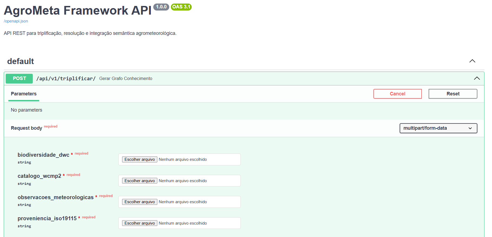

# AgroMeta

Framework de integração semântica que opera como um motor de triplificação (ETL Semântico) para harmonizar metadados agrometeorológicos. O projeto unifica dados biológicos (ocorrências de pragas), matrizes climáticas e metadados de proveniência em um Grafo de Conhecimento (RDF) interligado.

> **v1.0.0**: versão correspondente ao código avaliado na dissertação de mestrado.

*English summary: AgroMeta is a semantic ETL framework (FastAPI + RDFLib) that harmonizes agrometeorological metadata (ISO 19115, Darwin Core, WCMP 2) into an interlinked RDF knowledge graph, using AGROVOC, GeoSPARQL, SOSA and OWL-Time.*

## Demonstração



## Origem acadêmica

Este software foi desenvolvido na dissertação de mestrado do Programa de Pós-Graduação em Computação Aplicada da Universidade Estadual de Ponta Grossa (UEPG).

- Dissertação: [Framework para integração de padrões de metadados agrometeorológicos](https://ri.uepg.br/handle/123456789/5880)

**Como citar:**

FERNANDES, Wesley Vinicius. Framework para integração de padrões de metadados agrometeorológicos. 2026. Dissertação (Mestrado em Computação Aplicada) - Universidade Estadual de Ponta Grossa, Ponta Grossa, 2026.

## Tecnologias
- Python, FastAPI
- RDFLib, Pandas, xml.etree
- Padrões de Metadados: ISO 19115, Darwin Core (DwC), WMO Core Metadata Profile (WCMP) v2
- Ontologias: AGROVOC (FAO), GeoSPARQL, SOSA, OWL-Time
- Protégé (HermiT Reasoner) e GraphDB

## Pré-requisitos
- Python 3.12+ instalado
- Gerenciador de pacotes `pip`
- Acesso à internet para requisições de desambiguação ao endpoint SPARQL oficial da FAO
- GraphDB (opcional, para visualização e execução de consultas lógicas no grafo resultante)

## Instalação

Clone o repositório para a sua máquina local:
```bash

git clone https://github.com/WesleyVinicius/agrometa.git
cd agrometa
```

Crie e ative o ambiente virtual:
```bash

# Linux/macOS
python -m venv venv
source venv/bin/activate

# Windows
venv\Scripts\activate
```

Instale as dependências do projeto:
```bash

pip install -r requirements.txt
```

## Como usar a API

O AgroMeta foi desenhado para ser consumido como um serviço. Siga os passos abaixo para iniciar o servidor e realizar a triplificação dos dados.

### 1. Iniciando o Servidor
Com o ambiente virtual ativado, inicie a API localmente a partir do arquivo principal:

```bash

uvicorn triplificador_api:app --reload
```

### 2. Uso via Interface Interativa (Swagger UI)
A forma mais rápida de testar a orquestração é utilizando a documentação interativa gerada automaticamente pelo FastAPI:
1. Acesse `[http://127.0.0.1:8000/docs](http://127.0.0.1:8000/docs)` no seu navegador.
2. Expanda o endpoint **POST** `/api/v1/triplificar/`.
3. Clique no botão **"Try it out"**.
4. Faça o upload dos arquivos de amostragem localizados na pasta `dados/`:
   - `biodiversidade_dwc`: selecione `occurrence.txt`
   - `catalogo_wcmp2`: selecione `metadados_wcmp2_inmet.json`
   - `observacoes_meteorologicas`: selecione o arquivo CSV do INMET
   - `proveniencia_iso19115`: selecione `dados_iso.xml`
5. Clique em **"Execute"**. O sistema processará as ontologias da pasta `ontologia/` e salvará o arquivo `.ttl` final automaticamente na pasta `resultados/`.

### 3. Uso via Requisição HTTP (Integração com outros sistemas)
Se você deseja consumir esta API a partir de outro sistema ou via terminal, pode realizar uma requisição `multipart/form-data`. Exemplo usando cURL:

```bash

curl -X 'POST' \
  'http://127.0.0.1:8000/api/v1/triplificar/' \
  -H 'accept: application/json' \
  -H 'Content-Type: multipart/form-data' \
  -F 'biodiversidade_dwc=@dados/occurrence.txt' \
  -F 'catalogo_wcmp2=@dados/metadados_wcmp2_inmet.json' \
  -F 'observacoes_meteorologicas=@dados/INMET_S_PR_A873_MORRETES.csv' \
  -F 'proveniencia_iso19115=@dados/dados_iso.xml'
```

## Testes e Validação
A base ontológica (`mapeamento-agrometa.owl`) foi validada nativamente no **Protégé** com testes de Verificação de Consistência e Classificação Automática via **HermiT**. 

Para rodar os testes analíticos práticos e Questões de Competência (CQs):
1. Importe o arquivo `grafo_final_api_integrated.ttl` (gerado na pasta `resultados/`) para o **GraphDB**.
2. Execute consultas **SPARQL** para testar correlações ambientais (ex: incidência de *Spodoptera frugiperda* sob estresse hídrico) e verificar a desambiguação terminológica alcançada.

## Limitações conhecidas (v1.0.0)

Esta versão é a que foi avaliada na dissertação, e estas simplificações foram mantidas de propósito:

- O cruzamento semântico liga **todas** as ocorrências ao mesmo registro meteorológico e ao mesmo contexto institucional, sem considerar local nem data.
- O identificador da estação meteorológica é fixo (`API_GENERATED_STATION`).
- O CSV do INMET é lido por posição de coluna e espera o formato original do arquivo.
- O arquivo de saída tem nome fixo e é sobrescrito a cada requisição.
- A desambiguação depende dos serviços da FAO (AGROVOC). Se estiverem indisponíveis, é gerada uma URI local.
- Não há limite de tamanho de upload nem testes automatizados, e por isso a versão atual não é indicada para exposição pública.

## Roadmap

As melhorias planejadas estão na [milestone v1.1.0](https://github.com/WesleyVinicius/agrometa/milestones):

- [ ] #6 Testes automatizados e CI
- [ ] #7 Validação de entradas e limite de upload
- [ ] #8 Dockerfile e docker-compose (API + GraphDB)
- [ ] #9 Demo online da API
- [ ] #10 Cruzamento de ocorrências e observações por local e data

## Estrutura do Projeto
```text
agrometa/
├── dados/                              # Arquivos brutos de amostragem (CSV, XML, JSON)
├── ontologia/                          # TBox: Modelagem semântica e regras de domínio
│   └── mapeamento-agrometa.owl         
├── resultados/                         # ABox: Resultados gerados dinamicamente pela API
├── requirements.txt                    # Dependências do projeto (FastAPI, RDFLib, Pandas, etc.)
├── triplificador_api.py                # Pipeline principal (ETL Semântico) e API RESTful
└── README.md
```

## Contribuindo

Sugestões e correções são bem-vindas. Abra uma [issue](https://github.com/WesleyVinicius/agrometa/issues) descrevendo o problema ou a ideia. Para propor código, faça um fork, crie uma branch (`feature/...`, `fix/...` ou `docs/...`) e abra um Pull Request para a `master`.

## Licença
Este projeto está licenciado sob a Licença MIT.

## Autor
**Wesley Vinicius Fernandes**

- [LinkedIn](https://www.linkedin.com/in/wesleyviniciusf)
- [GitHub](https://github.com/WesleyVinicius)